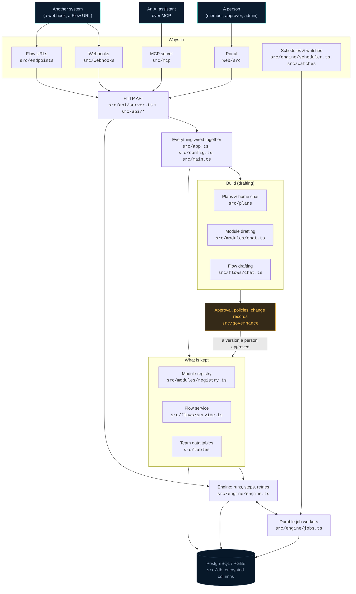
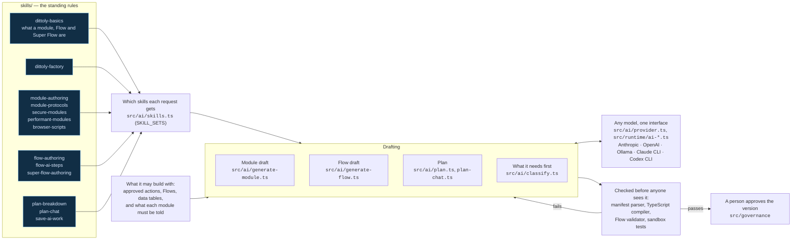
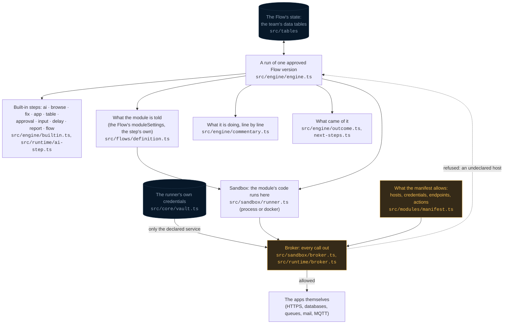

# The map: what lives where

Four pictures of the same thing. The first says how a request becomes a run; the second, where the AI and its
skills sit; the third, what a run may touch; the last names every directory, so a file can be found from the
picture.

The rule all of them obey: **a module keeps nothing, the Flow holds the configuration and the state, a Super Flow
is only a wrapper, and nothing runs until a person approves a version.**

## 1. From a request to a run

## 2. Where the AI sits, and what it is told

The skills in `skills/` are the standing rules. They are files, not prompts scattered in code: one set per kind of
drafting, read by `src/ai/skills.ts` and put in front of every request, whichever model runs.

## 3. What a run may touch

Every call leaves through the broker, which allows only what the approved manifest declares. The module itself
holds nothing: the Flow passes it everything, per step.

## 4. Every directory, in one place

| Where | What it is |
|---|---|
| `skills/` | The AI's standing rules, one folder per skill. Shipped with Dittoly, the same for every model. |
| `src/main.ts`, `src/app.ts`, `src/config.ts` | Start-up: read the settings, build every service once, serve. |
| `src/api/` | The HTTP API: `server.ts` plus a file per area (auth, governance, tables, watches, exports…). |
| `web/src/` | The portal people use: pages, the Live panel, the Flow graph, the approval rows. |
| `src/flows/` | What a Flow is: `definition.ts` (the schema), `service.ts` (checks, versions, approval), `chat.ts` (drafting), `template.ts`, `injection.ts`, `tests.ts`. |
| `src/modules/` | What a module is: `manifest.ts` (what it may do), `registry.ts` (versions), `chat.ts` (drafting), `health.ts` (drift), `run-fix.ts`. |
| `src/engine/` | Running: `engine.ts` (steps, retries, resolution), `jobs.ts` (durable workers), `builtin.ts` (ai/browse/fix/app steps), `scheduler.ts`, `commentary.ts`, `outcome.ts`. |
| `src/sandbox/` | Where module code runs and how it reaches the world: `runner.ts`, `broker.ts`, `browser.ts`, `live.ts`. |
| `src/runtime/` | The part that also ships inside an exported app: manifests, templates, transports, databases, the AI step, the providers. |
| `src/ai/` | Drafting with any model: `skills.ts`, `generate-module.ts`, `generate-flow.ts`, `plan.ts`, `provider.ts`, `models.ts`, costs and metering. |
| `src/governance/` | Who may approve what, policies, change records, allowed hosts. |
| `src/plans/` | A plan (a PDF or the home chat) becomes modules and Flows, built in order. |
| `src/core/` | The things everything uses: members, teams, the vault, crypto, audit, notifications, logging. |
| `src/db/` | The connection and the migrations (`src/db/migrations/*.sql`). |
| `src/tables/` | The teams' data tables: the Flow's own state between runs. |
| `src/mcp/` | Dittoly as an MCP server (agents use approved actions) and as an MCP client (imported tools). |
| `src/webhooks/`, `src/endpoints/`, `src/watches/` | The three ways another system starts a Flow: a webhook, a Flow URL, a watched inbox or feed. |
| `src/export/` | An approved Flow written out as a small app that runs without Dittoly. |
| `src/marketplace/`, `src/team-apps/`, `src/views/`, `src/insights/` | Sharing templates, the pages a team builds over a Flow, saved views, what it all saved. |
| `src/local/`, `src/cli/`, `src/runner/`, `src/devices/`, `src/git-sync/` | The local install (PGlite, launcher, cleanup), command-line tools, the remote code runner, devices, git export. |
| `test/`, `scripts/bench/` | The whole suite (including the browser end-to-end tests) and the benchmarks: capacity, and whether a model can do this work. |
| `docs/` | These pages. `install.md`, `server.md`, `governance.md`, `module-safety.md`, `super-flows.md`, `app-export.md`, and the rest. |
